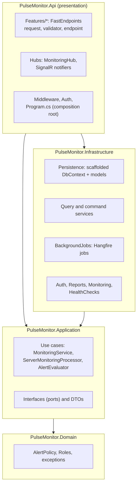
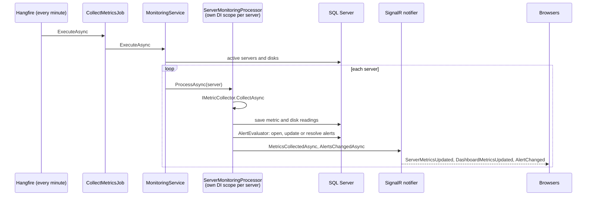
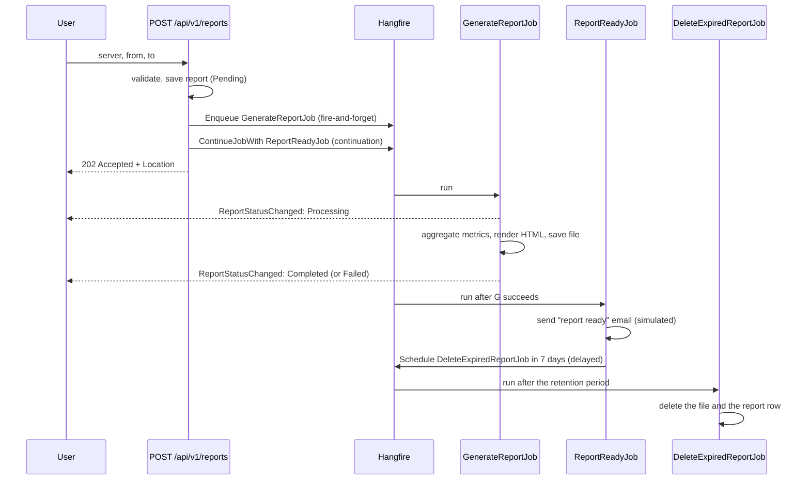
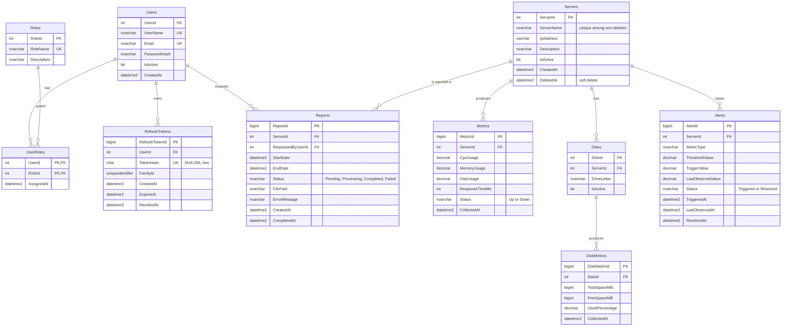

# Architecture

This document explains how PulseMonitor is put together: the layers, the main flows, the design
decisions and their reasons, and the database schema. For setup see [README.md](README.md).

## 1. Overview

PulseMonitor has two deployable parts:

- **API** (`src/PulseMonitor.Api`): one ASP.NET Core process that serves the REST API, the SignalR
  hub and the Hangfire server that runs the background jobs.
- **Frontend** (`frontend/`): a React single-page app, built to static files.

Both talk to one SQL Server database, which also holds Hangfire's job storage (`HangFire` schema).



Arrows are project references. `Domain` references nothing, and `Application` references only
`Domain`. Everything that touches a framework or the outside world (EF Core, Hangfire, SignalR,
the file system, JWT) is in `Infrastructure` or `Api`, behind interfaces that `Application` owns.

## 2. Layers

### Domain: `src/PulseMonitor.Domain`

Business rules that do not depend on storage or frameworks:

| Folder | Content |
|---|---|
| `Alerts/` | `AlertPolicy.Evaluate(value, threshold, hasActiveAlert)` decides whether an alert is triggered, resolved or left alone. `AlertAction` is its result. |
| `Users/` | `Roles` constants (`Admin`, `User`), used by the API's role checks. |
| `Exceptions/` | `NotFoundException`, `ConflictException`, `AuthenticationFailedException`. The global exception handler maps them to 404, 409 and 401. |

The domain is intentionally small. In a database-first project the entities are generated from
the schema, so they live in Infrastructure as persistence models (see
[Design decisions](#5-design-decisions)). The rules that matter, such as alert state transitions,
are pure functions here and are unit-tested without a database.

### Application: `src/PulseMonitor.Application`

Use cases, the interfaces they need (ports), DTOs and options. Organized by feature:

| Folder | Content |
|---|---|
| `Monitoring/` | The metric collection pipeline: `MonitoringService` (one cycle over all active servers) and `ServerMonitoringProcessor` (collect, save, evaluate alerts, notify for one server). Ports: `IMetricCollector`, `IMetricWriter`, `IMonitoringTargetRepository`, `IServerMonitoringExecutor`, `IMonitoringNotifier`. |
| `Alerts/` | `AlertEvaluator` applies `AlertPolicy` to every metric of a snapshot and persists the changes through `IAlertRepository`. `AlertThresholdOptions` holds the configured thresholds. The alert list query contract is `IAlertQueryService`. |
| `Servers/` | `IServerQueryService` (reads) and `IServerCommandService` (writes), with their DTOs and commands. |
| `Metrics/` | `IMetricsQueryService` and `MetricBuckets`, which chooses a bucket size so a history chart never gets more than 360 points. |
| `Dashboard/` | `IDashboardQueryService` and its DTOs. |
| `Reports/` | `IReportService`, `IReportNotifier`, the report DTOs and `ReportStatus`. |
| `Auth/` | `IAuthService` and its request and response models. |
| `Common/` | `PagedResult<T>`, `SortDirection`, `IEmailSender`. |

`DependencyInjection.AddApplication()` registers the use cases that have no infrastructure
dependency.

### Infrastructure: `src/PulseMonitor.Infrastructure`

Implementations of the Application interfaces:

| Folder | Content |
|---|---|
| `Persistence/` | `PulseMonitorDbContext` and `Models/`, scaffolded from the database. Hand-written partial classes add what scaffolding cannot: the soft-delete query filter (`.QueryFilters.cs`) and a UTC `DateTime` converter (`.Conventions.cs`). Also `QueryableExtensions` (sorting, paging). |
| `Services/` | EF Core query and command services: servers, metrics, dashboard. Also `LogEmailSender`, a simulated email sender. |
| `Monitoring/` | `SimulatedMetricCollector` (random readings), `MetricWriter`, `MonitoringTargetRepository`, `ScopedServerMonitoringExecutor`. |
| `Alerts/` | `AlertRepository` (the evaluator's storage) and `AlertQueryService` (alert history). |
| `Reports/` | `ReportService`, `ReportContentBuilder` (one aggregate query plus history and alerts), `HtmlReportRenderer`, `FileSystemReportStorage`, `ReportOptions`. |
| `BackgroundJobs/` | Hangfire job classes and the recurring job registration. |
| `Auth/` | `AuthService`, `AccessTokenFactory` (JWT), `RefreshTokenGenerator`, `AdminBootstrapper` (creates the first admin), options. |
| `HealthChecks/` | The Hangfire readiness check. |

`DependencyInjection.AddInfrastructure()` registers the DbContext, Hangfire, health checks and
every implementation. Options are validated at startup (`ValidateOnStart`), so a missing JWT key or
an invalid report setting stops the app immediately with a clear message.

### Presentation: `src/PulseMonitor.Api`

| Folder | Content |
|---|---|
| `Features/` | One folder per endpoint, each with its request, validator, endpoint and summary (FastEndpoints' REPR pattern), grouped by feature (Servers, Metrics, Alerts, Dashboard, Reports, Auth). |
| `Hubs/` | `MonitoringHub` (groups, presence), the message contracts (`IMonitoringClient`), `PresenceTracker`, and the SignalR implementations of `IMonitoringNotifier` and `IReportNotifier`. |
| `Middleware/` | `GlobalExceptionHandler`: maps exceptions to ProblemDetails responses and logs them. |
| `Auth/` | JWT bearer setup and `ClaimsPrincipal` helpers (`GetUserId`, `OwnerFilter`). |
| `HealthChecks/` | JSON writer for the health check responses. |
| `Program.cs` | Composition root: logging, services, middleware order, endpoints, hub, health checks, Swagger. |

The brief suggests `Controllers/`. This project uses FastEndpoints instead: each endpoint is a
small class with a single responsibility and a validator next to it. That avoids large controllers
and gives built-in versioning, validation and Swagger support.

## 3. Main flows

### Metric collection and alerts (recurring job)



- `[DisableConcurrentExecution]` stops two cycles from overlapping.
- Each server runs in its own DI scope (`ScopedServerMonitoringExecutor`), so it gets its own
  DbContext. One failing server is logged and skipped; it does not stop the cycle or affect the
  others.
- Notifications are sent **after** the data is saved. A failed push is only logged, because the
  data is already stored and a Hangfire retry would duplicate it.
- A filtered unique index (`UX_Alerts_Active`) allows only one open alert per server and metric,
  so the database itself prevents duplicate alerts.

### Report generation (fire-and-forget, continuation, delayed)



- `GenerateReportJob` has `AutomaticRetry(Attempts = 0)`. A failure sets the report to Failed with
  a message that is safe to show, and the job stays Failed in the Hangfire dashboard, where it can
  be retried. The continuation runs only after a successful retry.
- `ReportStatusChanged` goes only to the requesting user (`Clients.User`). Other users never see
  someone else's report status.
- Downloads require the access token like every other call, so there are no public report links.
  The frontend shows the report in a sandboxed iframe (no scripts, separate origin).

### Authentication

- **Login or register:** returns a 15-minute JWT access token in the body and sets a refresh token
  in an `httpOnly`, `Secure`, `SameSite=Strict` cookie limited to `/api/v1/auth`.
- **Refresh:** the token is rotated on every use. Only its SHA-256 hash is stored. All tokens from
  one sign-in share a family; reusing an already-rotated token revokes the whole family (theft
  detection). Claiming a token is a single atomic `UPDATE`, so two parallel refreshes cannot both
  succeed.
- **Frontend:** the access token is kept in memory only, never in `localStorage`. An axios
  interceptor adds it to requests and refreshes it once on a 401. Browser tabs coordinate through
  the Web Locks API so they don't race on the rotating cookie.
- **SignalR:** browsers cannot send headers on WebSockets, so the token is accepted from the query
  string, but only on the hub path.
- **Roles:** endpoints declare their roles (`Roles(Admin, User)`, or Admin only for server writes).
  Report queries add an owner filter for non-admins.

## 4. SOLID in the code

| Principle | Where | How |
|---|---|---|
| **Single responsibility** | `MonitoringService` / `ServerMonitoringProcessor` / `AlertEvaluator` / `AlertPolicy` | The cycle over servers, the steps for one server, applying thresholds, and the trigger/resolve rule are four separate classes, each with one reason to change. |
| | `ReportContentBuilder` / `HtmlReportRenderer` / `FileSystemReportStorage` | Gathering data, rendering HTML and storing files are separate; a PDF renderer or blob storage would replace only one of them. |
| | One endpoint per class in `Api/Features/*` | Each endpoint does one thing and has its own validator. |
| **Open/closed** | `IMetricCollector` | Real collection (for example Windows performance counters, which the hints mention) is added as a new class that replaces `SimulatedMetricCollector` in DI. The pipeline does not change. |
| | `IEmailSender`, `IReportStorage` | SMTP email or cloud storage are new implementations, with no change to the jobs. |
| **Liskov substitution** | `IMonitoringNotifier` | `ServerMonitoringProcessor` works the same with the SignalR notifier or a test fake; the contract is "best effort, must not throw into the job", and the processor guards it. |
| | `IMetricCollector` | Any collector must return a complete `ServerMetricSnapshot` for the server it was given; the writer, the alert evaluator and the notifiers rely only on that contract, so the simulated and a real collector are interchangeable. |
| **Interface segregation** | `IServerQueryService` vs `IServerCommandService` | Read endpoints depend only on queries; write endpoints only on commands. |
| | `IMonitoringNotifier` vs `IReportNotifier` | The monitoring pipeline doesn't see report notifications, and the report jobs don't see metric notifications. |
| | `IMetricWriter`, `IAlertRepository`, `IMonitoringTargetRepository` | Small, purpose-built ports instead of one generic repository. |
| **Dependency inversion** | `Application/Monitoring/IMonitoringNotifier.cs` ← `Api/Hubs/SignalRMonitoringNotifier.cs` | The Application layer defines what it needs ("tell clients about new metrics"); the API implements it with SignalR. The Application project has no SignalR reference. |
| | `Application/Common/Interfaces/IEmailSender.cs` ← `Infrastructure/Services/LogEmailSender.cs` | Same pattern for email. |

## 5. Design decisions

### EF Core database-first, with direct EF Core usage in query services

The SQL scripts (`001`–`004`) are the source of truth, as the brief asks. The DbContext and models
are scaffolded from the database. Hand-written additions live in partial classes, so re-scaffolding
does not overwrite them.

The brief asks to justify **repository pattern vs. direct EF Core usage**. This project uses both,
each where it fits:

- **Reads use EF Core directly** in query services (`ServerQueryService`, `MetricsQueryService`,
  `DashboardQueryService`, `AlertQueryService`). EF Core's `DbContext` is already a unit of work
  and `DbSet` is already a repository. A generic repository on top would hide `IQueryable`
  projections and make efficient queries harder to write. Each query projects straight into a DTO,
  so only the needed columns are read and nothing is tracked.
- **The monitoring pipeline uses small repositories** (`IAlertRepository`, `IMetricWriter`,
  `IMonitoringTargetRepository`) because its logic lives in the Application layer and must not
  depend on EF Core. These interfaces are shaped by the use case ("get the active alerts of a
  server", "apply these changes"), not as generic CRUD.

### CQRS without MediatR

Reads and writes are separated by interface (`I…QueryService` / `I…CommandService`), and every
endpoint is its own class. MediatR is optional in the brief; with FastEndpoints it would add a
second dispatch layer without adding value. Validation already runs before every endpoint, and
logging and exception handling are cross-cutting middleware.

### Soft delete for servers

Deleting a server keeps its metric and alert history (needed for reports and audits):
`Servers.DeletedAt` is set and a global EF query filter hides deleted servers. A filtered unique
index (`UX_Servers_ServerName_Active`) lets a new server reuse the name of a deleted one.

EF Core applies the filter to `Servers` queries but **not** through required navigations such as
`Alert.Server`. Queries that start from Alerts or Reports therefore add
`x.Server.DeletedAt == null` explicitly. This is noted in `DependencyInjection.cs`.

### Time handling

All timestamps are stored in UTC (`datetime2`). A value converter marks values read from the
database as UTC, so JSON responses always end in `Z` and browsers show local time correctly.

### Metric history bucketing

History requests are aggregated in SQL into fixed-size buckets (`MetricBuckets`), so a 7-day chart
returns at most 360 points (average and maximum per bucket) instead of about 10,000 raw rows.
Buckets are aligned to a fixed origin, so the same time range always produces the same buckets.

### Real-time design

- One strongly typed hub (`Hub<IMonitoringClient>`), so server-to-client messages are checked at
  compile time.
- Groups keep traffic proportional to what each user views: `dashboard` (every server's compact
  readings) and `server:{id}` (one server's full readings). The client re-joins its groups after a
  reconnect.
- Presence is tracked per user across connections, so several tabs count as one online user.
- The frontend polls only while the SignalR connection is down, and refetches once after
  reconnecting to catch up.

### Errors, validation and logging

- All errors are ProblemDetails (RFC 7807). Domain exceptions become 401, 404 or 409 with their
  message; anything else becomes a 500 without internal details, and the exception is logged.
- FluentValidation runs before each endpoint. Field names in messages match the JSON names, so the
  frontend shows them next to the right input.
- Serilog writes structured logs to the console and to daily JSON files. Request logging is enabled,
  with health probes and the Hangfire dashboard at Verbose level to keep the logs readable.

## 6. Design patterns used

| Pattern | Where |
|---|---|
| Clean Architecture / ports and adapters | Application interfaces implemented by Infrastructure and Api |
| REPR (request, endpoint, response) | `Api/Features/*` with FastEndpoints |
| CQRS (lightweight) | Query and command services; separate read DTOs |
| Repository (use-case specific) | `IAlertRepository`, `IMetricWriter`, `IMonitoringTargetRepository` |
| Unit of work | `DbContext`, one per request or per server per monitoring cycle |
| Strategy | `IMetricCollector`, `IEmailSender`, `IReportStorage` |
| Observer / publish-subscribe | SignalR groups and notifiers; `onHubEvent` subscriptions in the frontend |
| Options pattern with startup validation | `JwtOptions`, `ReportOptions`, `AlertThresholdOptions`, `AdminBootstrapOptions` |
| Global query filter | Soft delete of servers |
| Job chaining | Hangfire fire-and-forget → continuation → delayed |
| Token rotation with families | Refresh tokens and reuse detection |

## 7. Database schema

The scripts create the following tables. Every relationship is enforced with a foreign key.



Relationships required by the brief:

- **One-to-many:** Servers → Metrics, Servers → Disks → DiskMetrics, Servers → Alerts, Servers →
  Reports, Users → RefreshTokens.
- **Many-to-many:** Users ↔ Roles through `UserRoles`.

Changes from the schema in the hints document:

- **Explicit foreign keys and unique constraints.**
- **Users ↔ Roles is many-to-many** instead of a single `RoleId` column.
- **Refresh tokens have their own table:** a user can be signed in on several devices, and tokens
  are stored hashed with an expiry and a revocation time.
- **Disk readings are split** into `Disks` (per server) and `DiskMetrics` (per reading).
- **Alerts keep the trigger value and the last observed value** separately.
- **Reports record who requested them and why they failed.**
- **Timestamps are UTC `datetime2(3)`.**

Supporting indexes:

- `IX_Metrics_ServerId_CollectedAt`, `IX_DiskMetrics_DiskId_CollectedAt` and
  `IX_Alerts_ServerId_TriggeredAt` serve the history and list queries.
- The filtered unique indexes `UX_Alerts_Active` and `UX_Servers_ServerName_Active` enforce the
  business rules described above.

## 8. Frontend architecture

```
frontend/src/
├── app/          Router (lazy routes, guards), theme, layout (header, side navigation)
├── api/          axios client, ApiError (ProblemDetails → typed error), TanStack Query client
├── features/     One folder per feature: API calls, query hooks, types, feature components
│   ├── auth/       auth store, session refresh (Web Locks), interceptors, route guards
│   ├── realtime/   the single SignalR connection, group watching, presence
│   ├── servers/ metrics/ dashboard/ alerts/ reports/
├── pages/        Route components: compose features, own page state
├── components/   Shared UI: notifications queue, confirm dialog, loaders
├── hooks/        Generic hooks (useDebouncedValue, useNow)
└── utils/        Formatting helpers
```

- **Smart vs. presentational components:** pages and feature hooks (`useAlerts`,
  `useServerLiveUpdates`) fetch data and handle events. Tables, charts, tiles and cards
  (`AlertsTable`, `MetricChart`, `StatTile`, `ServerHealthCard`) only receive props.
- **State management:**
  - Server data lives in **TanStack Query**: caching, background refetch, and invalidation by query
    key after mutations and SignalR events.
  - Session state is a small external store read through `useSyncExternalStore`, so the axios
    interceptor and React share it.
  - List filters, sorting and paging are kept in the URL, so they survive reloads and can be shared.
- **API layer:**
  - Each feature has a `…Api.ts` file with typed functions.
  - Every failure is converted to one `ApiError` type with field errors, so forms can show the API's
    validation messages next to the inputs.
- **Real-time:**
  - There is one SignalR connection for the whole app. It connects on sign-in and disconnects on
    sign-out.
  - Features subscribe with `onHubEvent` and `watchServer` / `watchDashboard`, which are
    reference-counted.
  - Events update or invalidate the TanStack Query cache, so components don't need to know about
    SignalR.
- **Forms:** react-hook-form with zod schemas that mirror the API's validators. The API remains the
  authority.
- **Charts:** MUI X Charts, one chart per metric with a single axis each, and a table view for the
  same data. Status colors always come with an icon and a label, never color alone.
