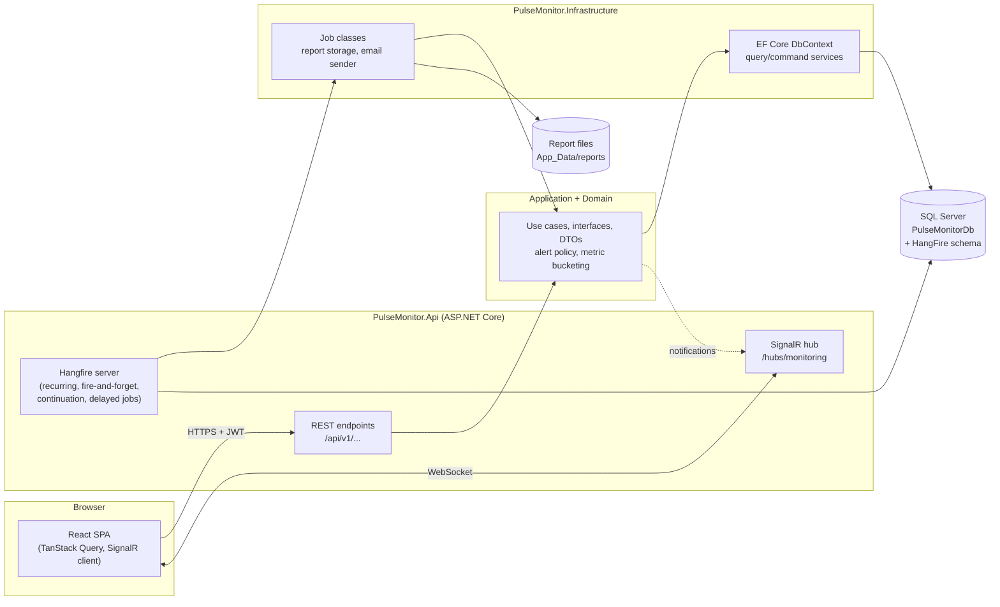
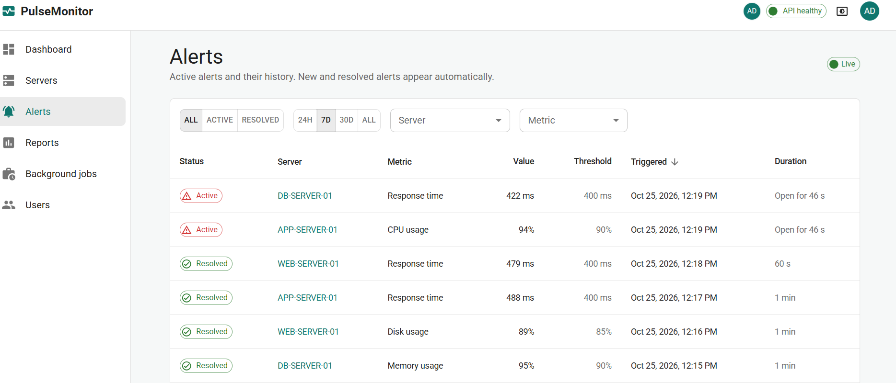
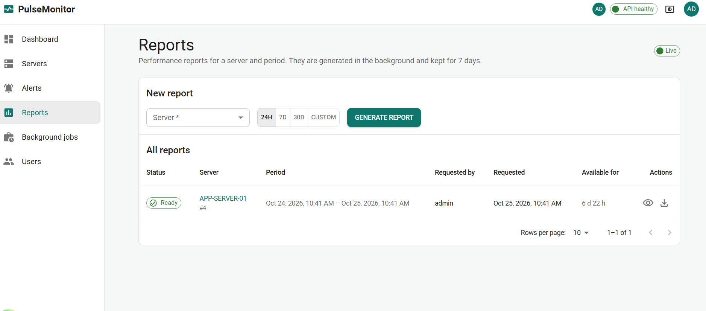
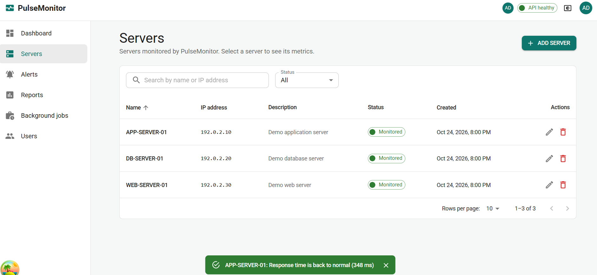

# PulseMonitor

A real-time server monitoring dashboard: a background job collects (simulated) metrics from
monitored servers every minute, raises and resolves alerts when thresholds are crossed, generates
performance reports on demand, and pushes all of it live to the browser.

Built for the GamaLearn Senior Full Stack technical assessment with .NET 10 and React + TypeScript.

> See [ARCHITECTURE.md](ARCHITECTURE.md) for the design and [DEPLOYMENT.md](DEPLOYMENT.md) for
> running it outside a developer machine.

## Features

| Area | What it does |
|---|---|
| **Authentication** | Registration and login with JWT access tokens (15 min) and rotating refresh tokens in an httpOnly cookie, with reuse detection. Roles: **Admin** and **User**. The first admin is created at startup from configuration. |
| **Servers** | List with search, sorting and paging; add, edit and delete (soft delete) for admins; read-only for users. |
| **Metrics collection** | Hangfire **recurring** job, every minute: CPU %, memory %, disk usage % (per disk), response time and Up/Down status for every active server. |
| **Dashboard** | Health card per server and the active alerts, updated live over SignalR. |
| **Server details** | Live stat tiles, per-disk usage, and history charts (CPU, memory, disk, response time) for the last 1 h, 6 h, 24 h or 7 d, with a table view of the same data. |
| **Alerts** | Thresholds from configuration (CPU > 90 %, memory > 90 %, disk > 85 %, response time > 400 ms). Alerts open and resolve automatically, appear as live notifications, and have a filterable, paged history page. |
| **Reports** | Request a report for a server and period (up to 31 days). Generated by a **fire-and-forget** job; a **continuation** job sends the (simulated) "report ready" email; a **delayed** job deletes the report after 7 days. Status (Pending, Processing, Completed, Failed) updates live; completed reports can be viewed in the app or downloaded. |
| **Presence** | Users currently online, shown in the header. |
| **Background jobs** | Hangfire dashboard at `/hangfire` (development): job history, scheduled jobs and retrying failed jobs. |
| **Operations** | Swagger/OpenAPI, liveness and readiness health checks, structured logging with Serilog, ProblemDetails (RFC 7807) error responses, API versioning. |
| **UI** | Responsive (phone, tablet, desktop) Material UI design with light, dark and system themes. |

## Technology stack

| Layer | Technologies |
|---|---|
| API | .NET 10, ASP.NET Core, [FastEndpoints](https://fast-endpoints.com/) 8 (endpoints, versioning, validation, Swagger), FluentValidation, SignalR |
| Data | SQL Server, EF Core 10 (database-first, scaffolded from the SQL scripts) |
| Background jobs | Hangfire 1.8 with SQL Server storage |
| Security | JWT bearer authentication (HS256), ASP.NET Core Identity password hasher (PBKDF2) |
| Logging and health | Serilog (console and JSON files), ASP.NET Core health checks |
| Frontend | React 19, TypeScript, Vite, Material UI 9, MUI X Charts, React Router 8, TanStack Query 5, axios, react-hook-form + zod, @microsoft/signalr |
| Tests | xUnit |

## Architecture



The solution follows Clean Architecture: `Domain` has no dependencies, `Application` depends only on
`Domain`, `Infrastructure` implements the `Application` interfaces, and `Api` wires everything
together. Details, SOLID examples and the database schema are in [ARCHITECTURE.md](ARCHITECTURE.md).

```
├── 001_CreateSchema.sql … 004_Auth.sql   Database scripts (database-first source of truth)
├── src/
│   ├── PulseMonitor.Domain           Alert policy, roles, domain exceptions
│   ├── PulseMonitor.Application      Use cases, interfaces, DTOs, monitoring and alert logic
│   ├── PulseMonitor.Infrastructure   EF Core, Hangfire jobs, auth, reports, health checks
│   └── PulseMonitor.Api              Endpoints, SignalR hub, middleware, Program.cs
├── tests/
│   ├── PulseMonitor.UnitTests
│   └── PulseMonitor.IntegrationTests
└── frontend/                         React + TypeScript single-page app
```

## Getting started

### Prerequisites

- [.NET 10 SDK](https://dotnet.microsoft.com/download)
- SQL Server 2019 or later (Developer or Express edition is fine) and `sqlcmd` or SSMS
- [Node.js 24](https://nodejs.org/) with npm

### 1. Create the database

Run the scripts **in order** against your SQL Server instance. `001` creates the `PulseMonitorDb`
database; the others are safe to run more than once.

```bash
sqlcmd -S localhost -E -C -I -i 001_CreateSchema.sql
sqlcmd -S localhost -E -C -I -d PulseMonitorDb -i 002_SeedData.sql
sqlcmd -S localhost -E -C -I -d PulseMonitorDb -i 003_ServerSoftDelete.sql
sqlcmd -S localhost -E -C -I -d PulseMonitorDb -i 004_Auth.sql
```

`-E` uses Windows authentication (use `-U` and `-P` for a SQL login), `-C` trusts the local
server certificate, and `-I` turns on `QUOTED_IDENTIFIER`, which the filtered indexes need.
The seed data adds the roles and three demo servers with disks. Hangfire creates its own
`HangFire` schema on first start.

### 2. Configure the API

The development connection string in `src/PulseMonitor.Api/appsettings.Development.json` points at
`Server=localhost` with Windows authentication; change it if your instance differs.

Secrets are not stored in the repository. Set them with user-secrets:

```bash
cd src/PulseMonitor.Api
dotnet user-secrets set "Jwt:SigningKey" "<a random string of at least 32 characters>"
dotnet user-secrets set "AdminBootstrap:Password" "<an admin password of at least 12 characters>"
```

On startup the API creates the `admin` user (email `admin@pulsemonitor.local`) with that password
if it does not exist yet. Anyone can register from the sign-up page; new accounts get the **User**
role.

### 3. Run the API

```bash
cd src/PulseMonitor.Api
dotnet run --launch-profile http
```

The API listens on `http://localhost:5184`:

| URL | Purpose |
|---|---|
| http://localhost:5184/swagger | Swagger UI (development only). Use **Authorize** with a token from `POST /api/v1/auth/login`. |
| http://localhost:5184/hangfire | Hangfire dashboard (development only): recurring, scheduled, succeeded and failed jobs, with retry. |
| http://localhost:5184/health/live | Liveness: the process is running. |
| http://localhost:5184/health/ready | Readiness: database reachable and a Hangfire server running. |

### 4. Run the frontend

```bash
cd frontend
npm install
npm run dev
```

Open http://127.0.0.1:5173. The Vite dev server proxies `/api`, `/hubs` and `/health` to the API,
so no CORS setup is needed in development.

### Running with Docker

Docker files are not included yet (see [Known limitations](#known-limitations-and-future-improvements)).
[DEPLOYMENT.md](DEPLOYMENT.md) describes how the API and frontend are built and configured for a
server or container environment.

## Testing

```bash
# Backend unit tests (alert policy, metric bucketing)
dotnet test tests/PulseMonitor.UnitTests

# Backend integration tests: they run against a dedicated SQL Server database named
# PulseMonitorIntegrationTestsDb. Create it with the scripts above (change the database name
# in 001_CreateSchema.sql), then:
dotnet test tests/PulseMonitor.IntegrationTests

# Frontend type check, lint and production build
cd frontend
npm run lint
npm run build
```

Stop the running API before `dotnet test`; it locks the build output.

## API documentation

The full, always up-to-date reference is the Swagger UI at `/swagger`. In short:

| Method and route | Access | Purpose |
|---|---|---|
| `POST /api/v1/auth/register`, `/login` | Anonymous | Create an account or sign in; returns an access token and sets the refresh cookie |
| `POST /api/v1/auth/refresh`, `/logout` | Refresh cookie | Rotate the refresh token, or revoke it |
| `GET /api/v1/servers` | Admin, User | Paged list with search and sorting |
| `GET /api/v1/servers/{id}` | Admin, User | One server |
| `POST`, `PUT`, `DELETE /api/v1/servers/{id}` | Admin | Create, update, soft-delete |
| `GET /api/v1/servers/{id}/metrics` | Admin, User | Metric history for a period, bucketed to at most 360 points |
| `GET /api/v1/servers/{id}/metrics/latest` | Admin, User | Latest reading with per-disk usage |
| `GET /api/v1/dashboard` | Admin, User | Overview of all servers and active alerts |
| `GET /api/v1/alerts` | Admin, User | Alert history with status, server, metric and period filters |
| `POST /api/v1/reports` | Admin, User | Request a report (202 Accepted) |
| `GET /api/v1/reports`, `/{id}` | Admin, User | Own reports (admins: all) |
| `GET /api/v1/reports/{id}/download` | Admin, User | The completed report as an HTML file |

Errors use ProblemDetails (RFC 7807) with field-level validation messages.

**SignalR hub** `/hubs/monitoring` (authenticated with the same access token):

| Direction | Name | Purpose |
|---|---|---|
| Client → server | `WatchDashboard`, `UnwatchDashboard` | Receive every server's readings |
| Client → server | `WatchServer(id)`, `UnwatchServer(id)` | Receive one server's full readings |
| Client → server | `GetOnlineUsers` | Current presence list |
| Server → client | `DashboardMetricsUpdated`, `ServerMetricsUpdated` | New readings |
| Server → client | `AlertChanged` | An alert was triggered or resolved |
| Server → client | `PresenceChanged` | Someone came online or went offline |
| Server → client | `ReportStatusChanged` | Progress of the user's own report |

## Screenshots

| | |
|---|---|
|  |  |
| Dashboard | Server details |
|  |  |
| Alerts | Reports |
|  |  |
| Servers | Phone, dark theme |

## Known limitations and future improvements

- **Background jobs page and user management page** in the frontend are placeholders. Jobs are
  monitored and retried in the Hangfire dashboard, which is only enabled in development; production
  needs an authorization filter on it.
- **Docker and CI/CD** are not set up yet: Dockerfiles for the API and frontend, a
  `docker-compose.yml` with SQL Server, and a GitHub Actions workflow for build and test.
- **Test coverage** is limited: unit tests cover the alert policy and metric bucketing, and two
  database integration tests cover alert evaluation and metric writes. Still missing:
  `WebApplicationFactory` API tests, application-service unit tests with mocks, and frontend
  component tests.
- **Metrics are simulated** with random values. A real collector (for example Windows performance
  counters) can replace `SimulatedMetricCollector` behind the same `IMetricCollector` interface.
- **Email is simulated**: `LogEmailSender` writes the message to the log.
- **Scaling out**: SignalR needs a backplane (for example Redis), and report files need shared
  storage, before running more than one API instance.
- **Not done yet:** rate limiting on the auth endpoints, a cleanup job for expired refresh tokens,
  pushing server list changes over SignalR, and alert thresholds editable from the UI.

## AI usage

See [AI_USAGE.md](AI_USAGE.md).
